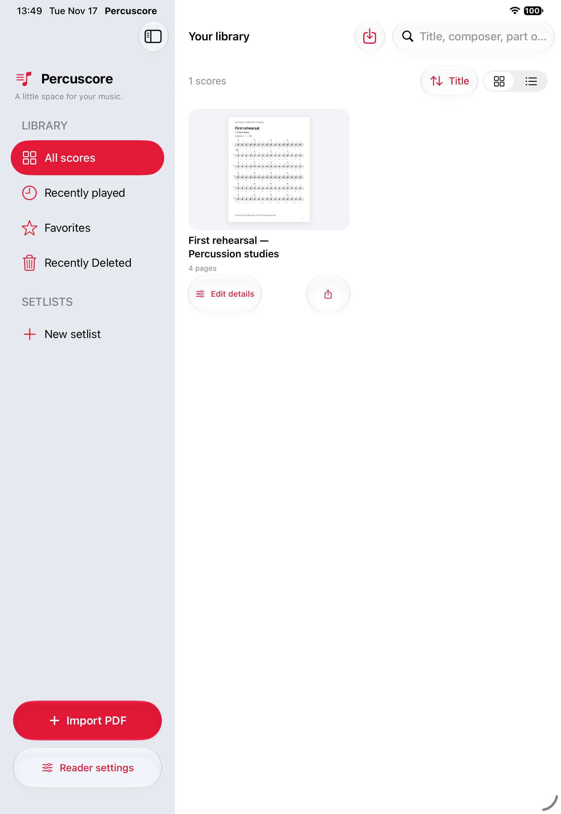
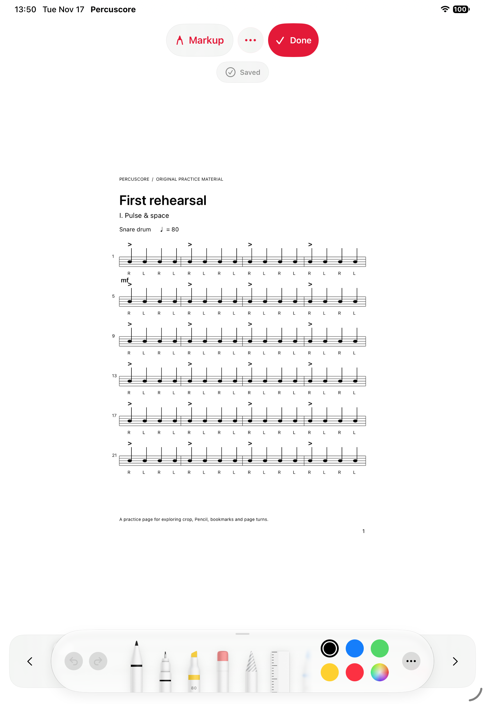

# Percuscore

[简体中文](README.zh-CN.md) · [Build and install](docs/BUILDING.md) · [Contributing](CONTRIBUTING.md)

An offline-first PDF sheet music reader for iPad, built with SwiftUI, PDFKit and PencilKit.

**Source preview:** this repository contains an Xcode project, not an App Store download or a universally installable IPA. No server, application account or third-party package is required. You need a Mac and Xcode to install it on an iPad.

## Screenshots

Actual iPad Simulator screenshots using the original bundled practice score. No personal scores or library are shown.

| Library / 谱库 | Markup / 标注 |
| --- | --- |
|  |  |

## Download and install from source

**[Download latest source ZIP](https://github.com/jessezhang2025-7741/percuscore/archive/refs/heads/main.zip)** · **[Step-by-step installation](docs/BUILDING.md)**

The latest source follows `main` and includes ongoing maintenance fixes. For a fixed older version, download the [v0.1.0-preview.1 source ZIP](https://github.com/jessezhang2025-7741/percuscore/archive/refs/tags/v0.1.0-preview.1.zip). That original preview does not include later fixes; see its [release page](https://github.com/jessezhang2025-7741/percuscore/releases/tag/v0.1.0-preview.1).

Distribution is **free source installation only**: no TestFlight, App Store or ready-to-install IPA. An iPad alone cannot install this ZIP. There is no Windows, Android or iPhone installer. A Mac alone can run the iPad Simulator; no standalone macOS installer is provided. Installing on an iPad requires a Mac, Xcode and your own Apple Account.

## Features

- Import PDFs through Files or drag and drop; organize scores with metadata, favorites, bookmarks and setlists.
- Mark pages with Apple Pencil using native PencilKit tools, erasing, lasso, ruler and undo/redo.
- Read with per-page zoom, pan and non-destructive crop; use full-page or two-stage half-page turns.
- Navigate with taps, swipes, page thumbnails, PDF contents, arrow keys and Space.
- Export original PDFs or copies with saved markings; export and merge complete library backups.
- Recover drafts, restore recently deleted scores and inspect local storage.

## Requirements and installation

- iPad running iPadOS 17 or later.
- Mac with full Xcode 26 or later and the appropriate iOS SDK; Python 3 for build metadata and validation tools.
- Your own Apple Account for a physical-device build; choose your own signing Team and a unique bundle identifier.

1. Clone or download this repository and open `Percuscore.xcodeproj`.
2. Choose an iPad Simulator and Run for an initial look, or configure signing and select your connected iPad.
3. On the iPad, trust the Mac, enable Developer Mode and follow Xcode's prompts.
4. Select **Try an original practice score** or **Import PDF**.

Apple's free Personal Team provisioning profiles expire after 7 days; rebuild and install over the existing app using the same Team and Bundle Identifier after expiry. Do not uninstall first. Export and verify a recoverable library backup before changing app identity or removing the app. See [Apple's account guide](https://developer.apple.com/help/account/basics/about-your-developer-account/) and the [detailed build guide](docs/BUILDING.md).

## Development

`Package.swift` tests the core library; use the Xcode project for the iPad app.

```sh
export DEVELOPER_DIR=/Applications/Xcode.app/Contents/Developer
python3 scripts/verify.py --level quick
xcodebuild -project Percuscore.xcodeproj -scheme Percuscore \
  -destination 'generic/platform=iOS Simulator' CODE_SIGNING_ALLOWED=NO build
```

Run `python3 scripts/verify.py --level full` for Simulator reader/UI and canvas-relaunch checks. Physical Apple Pencil and rehearsal checks are separate. See [validation](docs/VALIDATION-RUNNER.md), [architecture](docs/ARCHITECTURE.md) and [versioning](docs/VERSIONING.md).

## Status and limits

The app has previously been installed and launched on a physical iPad. That does not certify extended rehearsal, real Apple Pencil/palm rejection, keyboard-mode pedals, every Files provider or every large score. The public snapshot's fresh verification scope is recorded in [validation status](docs/VALIDATION-STATUS.md).

There is no cloud sync, collaboration, MIDI integration or dedicated Bluetooth-pedal configuration. Password-protected PDFs must be unlocked before import. Saved ink remains editable in Percuscore; marked PDF export flattens confirmed ink onto a copy and does not apply Crop or include unconfirmed drafts.

Imported files are copied into the local library; the app does not continuously synchronize or write back to the original Files provider. Back up before deleting the app or changing signing identity: [backup and recovery](docs/BACKUP.md), [storage](docs/STORAGE.md), [privacy](PRIVACY.md).

## License

[MIT](LICENSE). Use, modify, redistribute and commercialize the covered software, including closed-source derivatives, while retaining the required copyright and license notices. There is no requirement to contribute changes back or pay royalties.
