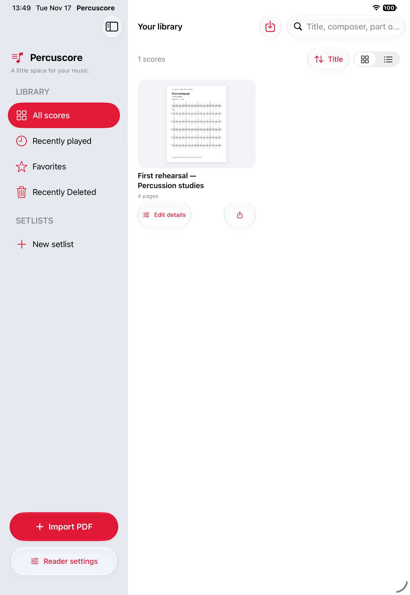
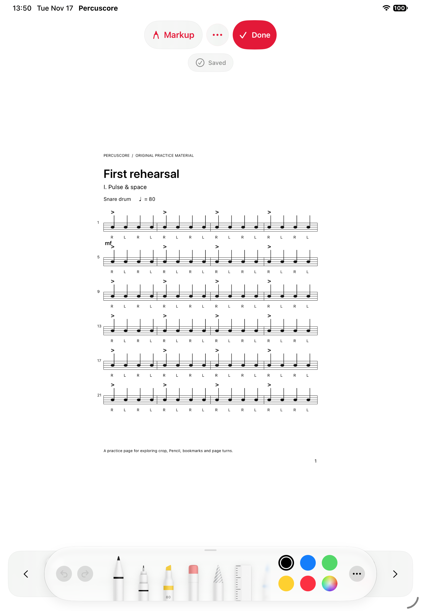

# Percuscore

[English](README.md) · [中文安装指南](docs/BUILDING.zh-CN.md) · [参与贡献](CONTRIBUTING.md)

离线优先的原生 iPad PDF 乐谱阅读器，使用 SwiftUI、PDFKit 和 PencilKit。

**当前为源码预览版。** 仓库提供 Xcode 工程，不是 App Store 下载，也不是可直接通用安装的 IPA。无需服务器、App 账号或第三方软件包；安装到 iPad 需要 Mac 和 Xcode。

## 界面预览

以下为 iPad 模拟器中的实际界面，使用应用自带原创练习谱，不含个人谱库或导入的乐谱。

| Library / 谱库 | Markup / 标注 |
| --- | --- |
|  |  |

## 下载源码并安装

**[下载最新源码 ZIP](https://github.com/jessezhang2025-7741/percuscore/archive/refs/heads/main.zip)** · **[中文安装指南](docs/BUILDING.zh-CN.md)**

最新源码随 `main` 更新，包含后续维护修正。需要固定旧版本时，可下载 [v0.1.0-preview.1 源码 ZIP](https://github.com/jessezhang2025-7741/percuscore/archive/refs/tags/v0.1.0-preview.1.zip)；它是原始预览快照，不包含后续修正。[发布页](https://github.com/jessezhang2025-7741/percuscore/releases/tag/v0.1.0-preview.1)提供该版本说明。

当前仅提供**免费的源码自签安装方式**，没有 TestFlight、App Store 或可直接安装的 IPA。只有 iPad 无法安装这个 ZIP；没有 Windows、Android 或 iPhone 安装包。只有 Mac 可以用 iPad 模拟器体验，但没有独立 macOS 安装包。真机安装需要 Mac、Xcode、自己的 Apple Account 和 iPad。

## 主要功能

- 通过 Files 或拖放导入 PDF；整理资料、收藏、书签及节目单。
- 使用原生 PencilKit 标注工具、橡皮、套索、直尺和撤销/重做。
- 逐页保存缩放与位置，非破坏性裁剪，支持整页和两阶段半页翻页。
- 点击、滑动、缩略图、PDF 目录、方向键和空格导航。
- 导出原始 PDF 或带已保存笔迹的副本；完整谱库备份与合并恢复。
- 草稿恢复、最近删除和本地存储管理。

## 安装要求

需要 iPadOS 17+ 的 iPad、安装完整 Xcode 26+ 的 Mac，以及用于构建信息和验收工具的 Python 3。真机安装使用你自己的 Apple Account。

1. 下载或克隆仓库，打开 `Percuscore.xcodeproj`。
2. 可以先选择 iPad 模拟器运行；真机请选择自己的签名 Team 和唯一 Bundle Identifier。
3. 连接 iPad，信任 Mac，按 Xcode 提示开启 Developer Mode。
4. 首次打开选择 **Try an original practice score** 生成原创练习谱，或选择 **Import PDF**。

免费 Personal Team 的设备配置描述文件有效期为 7 天，到期需用相同 Team 和 Bundle Identifier 重新构建并覆盖安装；不要先卸载。改变签名身份或卸载前，应导出并确认谱库备份可恢复。详见 [Apple 说明](https://developer.apple.com/help/account/basics/about-your-developer-account/)和[中文安装指南](docs/BUILDING.zh-CN.md)。

## 开发与验证

`Package.swift` 用于核心逻辑测试，iPad App 使用 Xcode 工程。

```sh
export DEVELOPER_DIR=/Applications/Xcode.app/Contents/Developer
python3 scripts/verify.py --level quick
xcodebuild -project Percuscore.xcodeproj -scheme Percuscore \
  -destination 'generic/platform=iOS Simulator' CODE_SIGNING_ALLOWED=NO build
```

完整模拟器检查使用 `python3 scripts/verify.py --level full`。当前公开快照的检查范围见[验证状态](docs/VALIDATION-STATUS.md)，工具说明见[验收指南](docs/VALIDATION-RUNNER.md)。

## 当前边界与数据

历史版本已安装并启动过实体 iPad；这不等于真实 Apple Pencil、掌触、长时间排练、所有 Files Provider、超大扫描谱或键盘模式踏板已完成验收。

不包含云同步、协作、MIDI 或专用蓝牙踏板配置。加密 PDF 需先解锁；带笔迹导出将确认的笔迹合成到副本，不包含未确认草稿或 Crop 效果。

导入是复制，不会实时同步或回写来源文件。卸载 App 或改变签名身份前先备份，并验证备份可恢复。详见[备份](docs/BACKUP.md)、[存储](docs/STORAGE.md)、[隐私](PRIVACY.md)和[架构](docs/ARCHITECTURE.md)。

## 许可证

采用 [MIT](LICENSE)：允许使用、修改、闭源、商用和收费分发，保留必要的版权与许可声明即可；不要求提交改进或支付分成。
